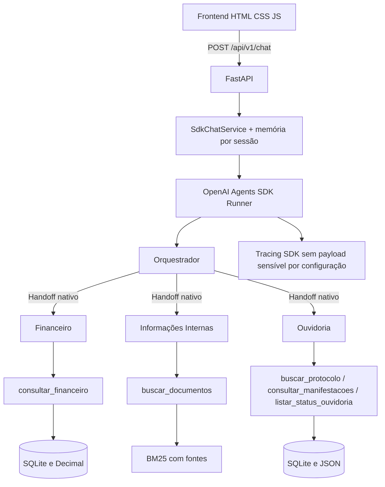

# Arquitetura vigente — Areco v0.2.34

A v0.2.33 altera **somente confiabilidade do frontend, versões exibidas e documentação**. Agentes, ferramentas, regras de negócio, memória e FastAPI mantêm o comportamento da v0.2.32.

## Componentes e responsabilidades

- `app/main.py`: ciclo de vida, bootstrap do banco, rotas `GET /`, `GET /health` e `POST /api/v1/chat` com contratos Pydantic, logs de execução e erro HTTP 503 em exceção.
- `app/sdk_integration/workflow.py`: Orquestrador e 3 especialistas com handoffs nativos e ferramentas. O Orquestrador conhece o cumprimento visual inicial e não o repete automaticamente.
- `app/sdk_integration/service.py`: chama `Runner.run`, preserva sessão SDK volátil, traços, handoffs, fontes e custos aproximados de tokens. Uma nova referência `OUV-NNNN` pode voltar ao orquestrador, evitando ficar presa no especialista anterior.
- `app/sdk_integration/session_memory.py`: até 30 trocas recentes, TTL 30 minutos, até 200 sessões no processo. `session_id` não é autenticação.
- `app/sdk_integration/tools.py`: acessa apenas os dados locais apropriados; filtros/plano financeiro são validados e consultas não aceitam SQL arbitrário.
- `app/knowledge/`: ingestão SQLite e recuperação textual BM25.
- `frontend/index.html`: mensagem inicial de boas-vindas, elementos do chat e versão visível.
- `frontend/app.js`: mensagens exibidas com `textContent`, requisição `fetch` com `AbortController` e timeout 120 s; texto restaurado se a conclusão não for confirmada. Sem retry automático ou persistência local de mensagem.

## Segurança e limitações

- Aplicação demonstrativa com **dados sintéticos**. Sem autenticação, permissões por usuário ou prontidão para internet aberta. Compose liga host apenas a `127.0.0.1:8000`.
- `.env` deve conter a chave OpenAI localmente e não ser versionado. `.env.example` usa valores de exemplo sem segredos.
- Traces utilizam `trace_include_sensitive_data=False`; a configuração não é garantia absoluta contra dados sensíveis em outros pontos de observabilidade.
- Sessão em RAM e no SDK local ao processo; reinícios ou múltiplos workers podem interromper a continuidade. Recarregar a página cria novo `session_id`.
- Limites de esquema: mensagem 2–1500 caracteres; `session_id` opcional. JSON devolve resposta, domínio, agente, fontes, handoffs, ferramentas, token_usage e trace_id.
- Timeout no navegador **não cancela necessariamente o processamento no servidor**. A UI não reenvia automaticamente para evitar duplicidade e cobrança extra. Não há idempotência de requisições neste MVP.
- A geração por LLM permanece probabilística; casos testados com sucesso não garantem cobertura universal.

## Evidências

- Suíte oficial de 12 casos avaliada positivamente pelo candidato (10 PASS + 2 REVIEW revisados) na versão anterior, com validação também na v0.2.27.
- Continuidade (8/8), mudança de domínio (4/4) e Financeiro (3/3) validados no Windows/Docker na v0.2.31.
- Saudação natural validada no navegador e com GPT-4.1 mini real (4/4) na v0.2.32.
- A v0.2.33 tem validação local do frontend; **Docker e navegador reais após atualização continuam pendentes**, bem como pytest completo e auditoria Git.
- Histórico completo e decisões em `docs/DEVELOPMENT_LOG.md` e `docs/DECISIONS.md`.

### v0.2.34 — Rascunho mantido até resposta confirmada

A interface mantém a última pergunta no campo de texto enquanto espera pela API e limpa o campo apenas quando recebe uma resposta válida. Se o pedido falhar ou estourar o timeout, a mensagem continua no campo para decisão de reenvio manual; nenhuma tentativa automática ocorre. Reiniciar o servidor não recupera respostas, e recarregar a aba reinicia a conversa e limpa o rascunho (sem sessionStorage/localStorage). O usuário deve estar ciente de que reenviar pode repetir o custo da API. Nenhum código de agentes, ferramentas ou sessão do backend mudou.

## v0.2.35 — Reconexão segura (alternativa A, exclusivamente frontend)

- `frontend/app.js` realiza `GET /health` (com `cache: no-store` e timeout) **antes** de criar qualquer `POST /api/v1/chat`. Falha nessa consulta significa que a mensagem ainda não foi enviada.
- O overlay (`frontend/index.html` + `styles.css`) interrompe interações, aplica blur ao restante da página, exibe spinner e permite cancelar. A verificação ocorre novamente a cada 3 segundos enquanto a aba permanece aberta.
- Quando `/health` confirma `status=ok` e `engine=sdk`, uma única mensagem pendente é enviada **uma vez**; **não** há reenfileiramento se o POST falhar ou receber timeout. Esse caso é incerto e precisa de decisão manual para evitar duplicação de chamadas pagas.
- Sem alteração em Agents SDK, `service.py`, sessões, ferramentas, SQLite ou rota FastAPI. Sem `sessionStorage`, `localStorage` ou service worker. Fechar/atualizar a aba perde o estado e não é possível recuperar o histórico do servidor após reinicialização do container.
- A solução não implementa idempotência end-to-end, fila persistente, retomada de execuções interrompidas ou garantia de entrega exatamente uma vez. Esses aspectos permanecem como roadmap.

### Evidência visual da indisponibilidade do backend (v0.2.35)

A captura de tela do overlay com blur, animação de reconexão e opção **Cancelar espera** está registrada em [EVIDENCIA_RECONECTAR_BACKEND_v0.2.35.md](EVIDENCIA_RECONECTAR_BACKEND_v0.2.35.md), com o arquivo original em `docs/assets/reconexao_backend_offline_v0.2.35.png`. O candidato confirmou a validação manual do cenário em 22/10/2026. A captura demonstra o estado visual offline, não a quantidade de POSTs processados.
