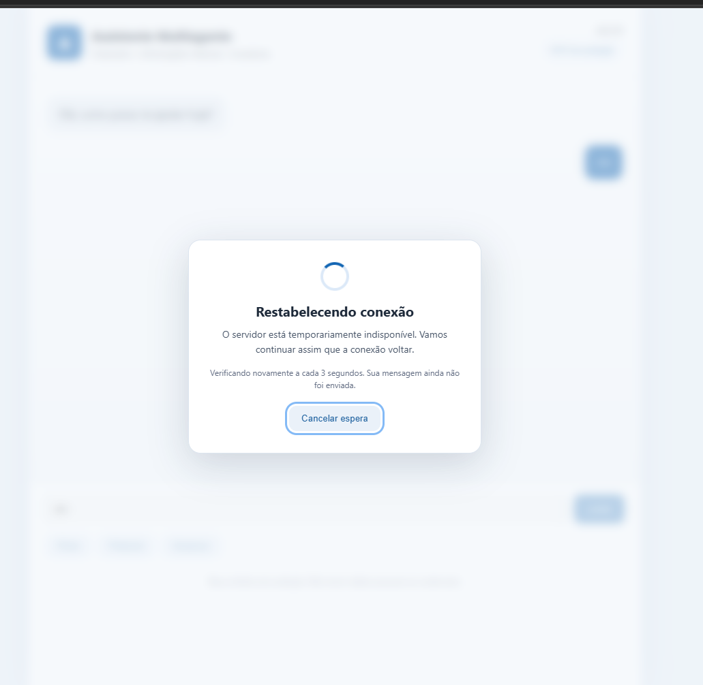

# Evidência — reconexão entre frontend e backend (v0.2.35)

**Data da validação manual:** 22/10/2026
**Ambiente:** interface web local, backend FastAPI em container Docker, OpenAI Agents SDK.
**Situação simulada:** container `app` interrompido enquanto a aba do assistente permanece aberta.



*Figura 1 — Tela de reconexão, registrada durante o teste manual da v0.2.35. Print original fornecido pelo candidato.*

## Tratamento da perda de conexão

1. Antes de enviar uma nova mensagem, o frontend consulta `GET /health` com `cache: no-store` e timeout curto.
2. Enquanto `/health` estiver indisponível, **o POST da mensagem ainda não é realizado**: uma mensagem permanece pendente na memória da aba.
3. O frontend aplica desfoque ao conteúdo de fundo, bloqueia novas interações e exibe a janela central com indicador animado e botão **Cancelar espera**.
4. Repete a verificação de saúde a cada 3 segundos, sem repetir POSTs durante a indisponibilidade.
5. Depois que `/health` voltar a responder corretamente, tenta **um único POST** para a mensagem pendente. A interface volta ao estado normal.
6. Se um POST já tiver sido iniciado e falhar, a conclusão pode ser incerta; **não** há reenvio automático, evitando duplicação de execuções e cobranças.

## Evidência e nível de validação

- **Observação direta da imagem:** overlay central, desfoque da interface, animação e botão de cancelamento foram exibidos conforme o desenho aprovado.
- **Confirmação do candidato:** o cenário de reconexão da v0.2.35 foi validado manualmente no frontend em 22/10/2026.
- **Não comprovado apenas pela captura:** contagem exata de POSTs, resposta final após reconexão e comportamento do botão de cancelamento. Para comprovar esses detalhes isoladamente, consultar logs/testes específicos.

## Reprodução manual

Com o container saudável, manter aberta a página `http://127.0.0.1:8000/` e executar em PowerShell:

```powershell
docker compose stop app
```

Na página, digitar uma pergunta e selecionar **Enviar**. Observar a janela de reconexão. Depois:

```powershell
docker compose start app
```

O fluxo esperado é desbloquear a interface e encaminhar a pergunta pendente quando a API voltar. Esse último envio pode consumir tokens OpenAI.

## Limites de arquitetura

- A fila é volátil, limitada a uma única mensagem pendente na aba; recarregar ou fechar a página perde o estado.
- A sessão do backend não é persistida entre reinicializações do container; pode ser necessário iniciar um novo contexto conversacional.
- Não existe fila durável, idempotência end-to-end nem retomada de requisições em execução.
- `/health` disponível não garante que a API OpenAI externa esteja funcionando; falhas após iniciar o POST não são tratadas como desconexão segura para reenvio.
- A prova de conceito não possui autenticação; deve continuar exposta somente em localhost.

**Arquivos de implementação:** `frontend/app.js`, `frontend/index.html`, `frontend/styles.css`.
**Arquivos de arquitetura relacionados:** `docs/ARCHITECTURE.md`, `docs/DELIVERY_CHECKLIST.md` e `docs/DEVELOPMENT_LOG.md`.
